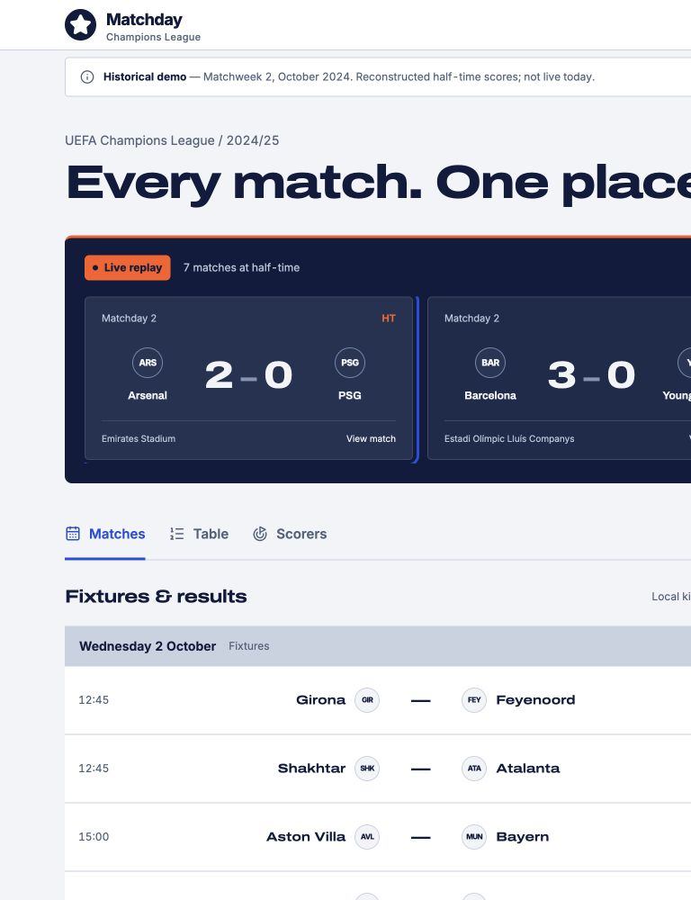
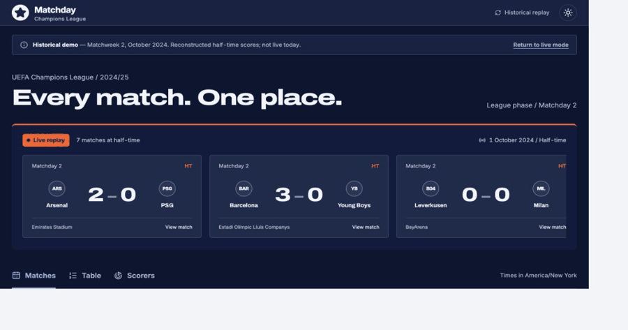

# Champions League Live Dashboard

[](http://localhost:8888/?demo=1)

Scores, fixtures, standings and scorers in one accessible matchday view.

[See it with live matches in progress — historical replay](http://localhost:8888/?demo=1)

**Public deployment is pending account setup.** No public URL or successful GitHub Actions run is claimed.





## What it does

Follow match scores and open the details of any fixture.
See upcoming kickoffs in your timezone, recent results and league positions.
Explore a sourced historical matchday when no current feed is connected.

## What it demonstrates

- Server-side API credentials, validated routes and normalized provider adapters.
- Visibility-aware polling, conservative minute clocks, caching and retry backoff.
- Responsive tables, keyboard navigation, reduced-motion support and clear failure states.

## Architecture

```text
Browser (React SPA)
      | fetch('/api/cl/matches') — no key
      v
Netlify Function / Vercel API route
      | validate -> allowlist -> rate limit -> cache
      | read FOOTBALL_API_KEY at server runtime
      v
football-data.org v4 / API-Football v3
      | normalize only the fields the UI uses
      v
Function memory -> CDN cache -> React Query -> dashboard
```

See [Architecture](docs/ARCHITECTURE.md), [Design](docs/DESIGN.md), and the measured threat model in [SECURITY.md](SECURITY.md).

## Tech stack

| Layer      | Choice                                              |
| ---------- | --------------------------------------------------- |
| UI         | React, TypeScript strict, Vite                      |
| Styling    | Tailwind CSS, self-hosted Archivo and Inter, Lucide |
| Data       | TanStack Query v5, Zod provider contracts           |
| Server     | Shared handler, Netlify Functions, Vercel bridge    |
| Tests      | Vitest, React Testing Library, MSW                  |
| Checks     | ESLint, Prettier, npm audit, gitleaks, bundle scan  |
| Automation | GitHub Actions, Dependabot                          |

Versions are pinned in package.json and package-lock.json.

## Getting started locally

New to these tools? Start with [START-HERE.md](START-HERE.md).

Install Node.js 24 LTS and npm. Use this project directory, or clone your published GitHub repository with `git clone` and enter its directory. A repository URL cannot be supplied until you create that repository.

```sh
npm install
npm run dev:netlify
```

Open [localhost:8888/?demo=1](http://localhost:8888/?demo=1). No key or account is needed for this historical demo. Keep the terminal open. Control-C stops the server.

For the live feed, get a key from [football-data.org](https://www.football-data.org/client/register):

```sh
cp .env.example .env
```

Set the key in `.env`, keep `DATA_PROVIDER=football-data`, set `ALLOWED_ORIGIN=http://localhost:8888`, then restart the server. Open [live mode](http://localhost:8888/).

`dev:netlify` builds the app and starts pinned Netlify CLI 27.5.2 without account login. The CLI is run through npx to isolate its tooling dependencies. The first invocation needs internet access. Netlify uses Vite's compiled preview on internal port 4179 so the production CSP remains enforced; rebuild after code edits. `npm run dev` is frontend-only Vite authoring, not a complete live server. Opening index.html directly cannot run React; it now displays launch instructions instead of a blank page.

If file watching reports EMFILE on macOS, run `CHOKIDAR_USEPOLLING=true npm run dev:netlify`. If port 8888 or 4179 is busy, stop the other project process using it before restarting.

## Environment variables

| Name             | Required?                           | Where                                      | Purpose                                                |
| ---------------- | ----------------------------------- | ------------------------------------------ | ------------------------------------------------------ |
| FOOTBALL_API_KEY | Live mode only                      | Ignored local .env; hosting runtime secret | Provider credential                                    |
| DATA_PROVIDER    | Optional; defaults to football-data | Server environment                         | football-data or api-football                          |
| ALLOWED_ORIGIN   | Live mode                           | Server environment                         | Exact local or deployed origin, without trailing slash |

**Never prefix a secret with VITE\_.** Vite exposes those values in public JavaScript. The browser never needs this key. Do not place secrets in netlify.toml, public files or repository settings meant for public configuration. Netlify runtime variables must include Functions scope where scope controls are available. [Netlify's runtime-variable documentation](https://docs.netlify.com/build/functions/environment-variables/)

## Deployment

### Netlify — primary

1. Create your GitHub and Netlify accounts. Publish this existing local repository to GitHub. The source is already a Git repository; review the files before publishing.
2. In Netlify, choose Add new project/site → Import an existing project. Select the GitHub repository.
3. Use `npm run build`, publish directory `dist`, functions directory `netlify/functions`, and Node 24. The checked-in netlify.toml supplies these settings.
4. Set FOOTBALL_API_KEY, DATA_PROVIDER and ALLOWED_ORIGIN in Netlify's environment settings. Apply them to the deployment contexts you use and include Functions scope. Never expose the credential through a client variable.
5. Deploy. Copy the site's HTTPS origin, set ALLOWED_ORIGIN to that exact origin and redeploy. A custom domain is optional; changing it requires updating this value too.
6. Verify the live mode and historical demo. In DevTools → Network, requests must go to same-origin `/api/cl/*` (rewritten internally to `/.netlify/functions/cl/*`), with no provider authentication header. The browser normally shows the original `/api/` URL, not the internal rewrite.
7. Search every production JavaScript asset for the exact key locally. Do not paste the key into an issue, search engine or screenshot. Also run `npm run check:secrets` against the local production build. A server-runtime secret need not be copied into CI merely for scanning.
8. Confirm that invalid paths and parameters return 400, POST returns 405, foreign Origin returns 403, and no response contains the key. Validate genuine feed access, current-season coverage and CDN cache behavior with your account.
9. Run `node scripts/set-publication.mjs` with your HTTPS site origin and `owner/repository` as its two arguments. This sets real README links, CI badge and absolute OG image URL. Run `npm run format` and rebuild after it. Set the GitHub About website field to the same live URL and upload public/og-image.png as the repository social preview.

A folder-only static drag-and-drop deployment is insufficient for authenticated live data; it must deploy the functions as well.

### Vercel — alternative

Import the same repository in Vercel. Use the Vite framework preset, build `npm run build`, output `dist`, and Node 24. Set the same three environment variables for Production, Preview and Development with the appropriate origin in each context. The `api/cl.ts` Node bridge delegates to the shared handler. vercel.json provides path rewrites and security headers. Repeat the same credential, validation and live-feed checks after deploying. Both platform configurations are supplied; neither has been tested in a real hosting account yet.

## Data sources and rate limits

[football-data.org](https://www.football-data.org/pricing) is the default: its free plan lists 12 competitions, delayed scores and 10 requests/minute. Polling more often does not remove that delay. Verify scorer entitlement and competition coverage with your key; the UI isolates failures in individual sections.

[API-Football](https://www.api-football.com/pricing) is selectable through DATA_PROVIDER. Its free allowance is 100 requests/day, with season restrictions. Verify 2026 access with a live key before relying on it. The dashboard polling cadence can exhaust that daily allowance; it is not a recommended unattended free-plan deployment. Paid entitlements and provider delays can change.

The sample is a **historical reconstruction**, not an original live API capture. It contains 36 match facts from matchdays 1–2 of 2024/25 and seven reconstructed half-time matches on 1 October. Source URLs and retrieval time are in public/demo/snapshot.json. Table totals are computed from completed results before the evening games; unresolved ties are alphabetical. Goal totals include the reconstructed first halves; missing assists and appearances remain blank. The UI explicitly labels all of this.

`node scripts/build-historical-demo.mjs` reproduces the archive from ESPN facts. When a live key is available during a matchday, `node scripts/capture-live-demo.mjs http://localhost:8888` captures normalized provider data only if at least two matches are genuinely IN_PLAY or PAUSED. It replaces the snapshot, so review the provenance and appearance before rebuilding and publishing. Never change finished statuses to invent a captured live feed.

## Project structure

```text
api/cl.ts                          Vercel HTTP bridge
netlify/functions/cl.ts            Netlify entry point
netlify/functions/_lib/             Validation, caches, limits, redaction
netlify/functions/_lib/providers/   Types and both adapters
src/components/                    Dashboard and all interface states
src/hooks/                         Queries, visibility and local clock
src/lib/                           API transport, time and formatting
public/demo/                       Sourced historical snapshot
public/fonts/                      Self-hosted fonts and licenses
public/og-image.png                 1200 × 630 social preview
scripts/                           Capture, publication and secret checks
tests/                             Unit, component/MSW and function tests
docs/                              Design, architecture and verification
.github/                           CI and Dependabot
```

## Roadmap and known limitations

The local build is usable. Public deployment, genuine live-key integration, the GitHub About/social settings, and an actual GitHub Actions run await accounts. Free-tier scores can lag a broadcast; quiet weeks are normal. Unavailable live data remains an honest error/empty state. The supplied archive is deliberately not presented as today's football.

Per-IP throttles and the upstream budget are per warm function instance, not distributed quota guarantees. A popular public service needs additional edge controls. CORS is not bot protection. See SECURITY.md.

Local verification: 44 tests pass; build and bundle checks pass. The complete check record is in [VERIFICATION.md](docs/VERIFICATION.md). Lighthouse Performance / Accessibility / Best Practices / SEO are **not measured**: headless Chrome exited before Lighthouse could connect. The target is ≥90 in each category, to be measured after deployment. A real screen-reader listening pass also remains unverified; DOM accessibility structure and keyboard interactions were inspected.

## Licence

[MIT](LICENSE). Font licenses are included. Club and competition names belong to their owners. This project is not affiliated with UEFA.

## Recent results archive

The History tab works without credentials and includes completed 2026/27 and 2025/26 league-phase and knockout results. Static ESPN snapshots were retrieved on 13 September 2026; each match links to its source. Shootout and aggregate scores are shown separately. Refresh via `node scripts/update-history.mjs` followed by a build. This archive is independent of the 2024/25 replay and keyed live feed.
